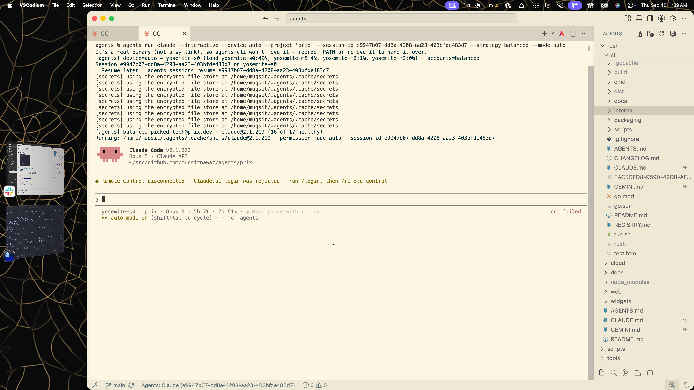

## Story

You already reported this. **PHNX-3970 and PR #57 are the existing fix.** At the start of this investigation, the PR remained open awaiting independent review and conflicted with main. Its body records a 0.9.364 development install; zion had 0.9.367, whose installed VSCodium code still contained the faulty workspace-to-project conversion. That installation was verified; the precise event that replaced the development build is unknown. The owner reviewed this plan and authorized the fix through delivery on 10 September.

<aside class="artifact-callout"><strong>The rule:</strong> ordinary New / Auto / Pick Host keeps the exact workspace folder. If you opened <code>agents</code>, stay there. If you opened <code>agents/prix</code>, stay there. Only <strong>Pick Project</strong> may choose a managed project’s default folder.</aside>

## Figure

<figure class="artifact-figure artifact-behavior">
<section data-state="current" data-evidence="mockup">
<h3>Observed: root becomes a child</h3>
<svg class="artifact-diagram" viewBox="0 0 500 300" role="img" aria-label="Current launch: agents workspace emits project prix and lands in agents slash prix">
<rect x="1" y="1" width="498" height="298" rx="8" fill="#faf6e3" stroke="#d4cbb4"/>
<path d="M9 1H491Q499 1 499 9V42H1V9Q1 1 9 1" fill="#ded8c2"/>
<text x="20" y="27" fill="#47453e" font-family="system-ui" font-size="14">VSCodium · agents workspace · New Claude</text>
<text x="22" y="76" fill="#25434b" font-family="monospace" font-size="15">agents % agents run claude</text>
<text x="22" y="104" fill="#25434b" font-family="monospace" font-size="15">  --interactive --device auto</text>
<rect x="35" y="117" width="184" height="29" rx="4" fill="#f4d6cf"/>
<text x="42" y="137" fill="#872f22" font-family="monospace" font-size="15">--project 'prix'</text>
<path d="M245 151V190" fill="none" stroke="#872f22" stroke-width="2"/>
<path d="M239 182L245 191L251 182" fill="none" stroke="#872f22" stroke-width="2"/>
<text x="22" y="218" fill="#47453e" font-family="system-ui" font-size="14">Claude Code starts on the worker</text>
<text x="22" y="249" fill="#872f22" font-family="monospace" font-size="18">…/agents/prix</text>
<text x="22" y="278" fill="#736b59" font-family="system-ui" font-size="12">Reconstruction of the supplied screenshot; flags shortened.</text>
</svg>
</section>
<section data-state="proposed" data-evidence="mockup">
<h3>Required: keep the opened root</h3>
<svg class="artifact-diagram" viewBox="0 0 500 300" role="img" aria-label="Proposed launch: agents workspace emits cwd for agents and lands at the corresponding remote root">
<rect x="1" y="1" width="498" height="298" rx="8" fill="#faf6e3" stroke="#d4cbb4"/>
<path d="M9 1H491Q499 1 499 9V42H1V9Q1 1 9 1" fill="#ded8c2"/>
<text x="20" y="27" fill="#47453e" font-family="system-ui" font-size="14">VSCodium · agents workspace · New Claude</text>
<text x="22" y="76" fill="#25434b" font-family="monospace" font-size="15">agents % agents run claude</text>
<text x="22" y="104" fill="#25434b" font-family="monospace" font-size="15">  --interactive --device auto</text>
<rect x="35" y="117" width="364" height="29" rx="4" fill="#dcece7"/>
<text x="42" y="137" fill="#166054" font-family="monospace" font-size="14">--cwd '/Users/muqsit/…/agents'</text>
<path d="M245 151V190" fill="none" stroke="#166054" stroke-width="2"/>
<path d="M239 182L245 191L251 182" fill="none" stroke="#166054" stroke-width="2"/>
<text x="22" y="218" fill="#47453e" font-family="system-ui" font-size="14">CLI translates the home prefix; suffix stays exact</text>
<text x="22" y="249" fill="#166054" font-family="monospace" font-size="18">…/agents</text>
<text x="22" y="278" fill="#736b59" font-family="system-ui" font-size="12">Target behavior mockup; not an installed-flow verification.</text>
</svg>
</section>
</figure>

The destination follows the opened folder. Choosing a device must never choose a different project.

## What happened to the earlier fix

This table records the state before the PR refresh in this session.

| Stage | Evidence as of 10 September 2026 | Meaning |
| --- | --- | --- |
| Reported and implemented | PHNX-3970 is In Review; PR #57 contains the remote fix | This is existing work, not a new ticket |
| Review | PR reviews array is empty; reviewer request names bisma-nawazz; 5 September comment identifies review as the remaining gate | No independent verdict was posted |
| Merge | PR #57 is OPEN, CONFLICTING / DIRTY | It never reached main and now needs conflict resolution |
| Development install | PR body records a 0.9.364 install in VS Code and VSCodium | A historical claim, not present-day release proof |
| Current installation | VSCodium extension 0.9.367 contains the implicit resolver expression | The currently installed code still has this bug |
| Current screenshot | Command includes `--project 'prix'`; Claude shows `…/agents/prix` | Direct evidence of the user-visible failure |

<figure class="artifact-figure artifact-figure-diagram">
<svg class="artifact-diagram" viewBox="0 0 1050 185" role="img" aria-label="Delivery sequence: fix on branch, missing review and merge, release from main, installed bug">
<defs><marker id="delivery-arrow" markerWidth="8" markerHeight="8" refX="7" refY="4" orient="auto"><path d="M0 0L8 4L0 8Z" fill="#aab4c0"/></marker></defs>
<rect x="20" y="35" width="205" height="90" rx="6" fill="#18262f" stroke="#92b6c6"/>
<text x="37" y="67" fill="#e7edf2" font-size="17" font-family="system-ui">Fix on PR branch</text><text x="37" y="96" fill="#aab4c0" font-size="14" font-family="monospace">#57 · 1f54bf9</text>
<path d="M225 80H285" stroke="#e3ad63" stroke-width="2" stroke-dasharray="5 4"/>
<path d="M260 66V94M271 66V94" stroke="#e3ad63" stroke-width="3"/>
<rect x="285" y="35" width="225" height="90" rx="6" fill="#30291e" stroke="#e3ad63"/>
<text x="303" y="67" fill="#f5d6a7" font-size="17" font-family="system-ui">Review + merge absent</text><text x="303" y="96" fill="#e3ad63" font-size="14" font-family="system-ui">Now also conflicting</text>
<path d="M510 80H570" stroke="#aab4c0" stroke-width="2" marker-end="url(#delivery-arrow)"/>
<rect x="580" y="35" width="190" height="90" rx="6" fill="#18262f" stroke="#92b6c6"/>
<text x="598" y="67" fill="#e7edf2" font-size="17" font-family="system-ui">Main still has bug</text><text x="598" y="96" fill="#aab4c0" font-size="14" font-family="monospace">8fc4f7c</text>
<path d="M770 80H825" stroke="#aab4c0" stroke-width="2" marker-end="url(#delivery-arrow)"/>
<rect x="835" y="35" width="195" height="90" rx="6" fill="#30221f" stroke="#dfaa95"/>
<text x="853" y="67" fill="#f2d3c9" font-size="17" font-family="system-ui">Installed on zion</text><text x="853" y="96" fill="#dfaa95" font-size="12" font-family="monospace">0.9.367 · bug present</text>
<text x="20" y="159" fill="#aab4c0" font-size="13" font-family="system-ui">Delivery-state diagram. Broken connector = uncompleted gate; installed package lineage beyond the observed code is unverified.</text>
</svg>
</figure>

## Intent and scope

**Intended:** open a new session in the workspace you are using. **Observed:** ordinary New Claude chooses the managed project `prix` and narrows the folder to `agents/prix`. **Delta:** a containment label becomes an unsolicited destination choice.

Keep the existing device picker, account rotation, session identity, and explicit Pick Project behavior. Do not force every folder to its Git root: a deliberately opened nested folder must remain nested. Do not alter the project definitions or add a second project-resolution mechanism.

## Data path and root cause

<figure class="artifact-figure artifact-figure-diagram">
<svg class="artifact-diagram" viewBox="0 0 990 380" role="img" aria-label="Current component call path: workspace selection, project inference, command builder, CLI project resolution, remote harness">
<defs><marker id="trace-arrow" markerWidth="8" markerHeight="8" refX="7" refY="4" orient="auto"><path d="M0 0L8 4L0 8Z" fill="#a8bdc6"/></marker></defs>
<rect x="20" y="26" width="950" height="149" rx="8" fill="none" stroke="#617480" stroke-dasharray="5 4"/>
<text x="37" y="49" fill="#a8bdc6" font-size="14" font-family="system-ui">Extension components · TypeScript</text>
<rect x="40" y="72" width="240" height="72" fill="#18262f" stroke="#92b6c6"/>
<text x="54" y="99" fill="#e7edf2" font-size="16" font-family="system-ui">Workspace selector</text><text x="54" y="125" fill="#b5c1cb" font-size="13" font-family="monospace">cwd = …/agents</text>
<path d="M280 108H357" stroke="#a8bdc6" stroke-width="2" marker-end="url(#trace-arrow)"/>
<text x="297" y="92" fill="#a8bdc6" font-size="12" font-family="system-ui">cwd</text>
<rect x="365" y="72" width="255" height="72" fill="#30221f" stroke="#dfaa95"/>
<text x="380" y="99" fill="#f2d3c9" font-size="16" font-family="system-ui">Implicit project inference</text><text x="380" y="125" fill="#dfaa95" font-size="13" font-family="monospace">launchAgent → projects view</text>
<path d="M620 108H697" stroke="#a8bdc6" stroke-width="2" marker-end="url(#trace-arrow)"/>
<text x="633" y="92" fill="#dfaa95" font-size="12" font-family="system-ui">prix</text>
<rect x="705" y="72" width="245" height="72" fill="#18262f" stroke="#92b6c6"/>
<text x="720" y="99" fill="#e7edf2" font-size="16" font-family="system-ui">Launch command builder</text><text x="720" y="125" fill="#b5c1cb" font-size="13" font-family="monospace">--project prix; drops cwd</text>
<path d="M828 144V213H492V238" fill="none" stroke="#a8bdc6" stroke-width="2" marker-end="url(#trace-arrow)"/>
<text x="528" y="203" fill="#a8bdc6" font-size="13" font-family="system-ui">CLI argv via integrated terminal</text>
<rect x="365" y="246" width="255" height="72" fill="#18262f" stroke="#92b6c6"/>
<text x="380" y="273" fill="#e7edf2" font-size="16" font-family="system-ui">CLI project resolver</text><text x="380" y="299" fill="#b5c1cb" font-size="13" font-family="monospace">defaultPath ?? root</text>
<path d="M620 282H697" stroke="#a8bdc6" stroke-width="2" marker-end="url(#trace-arrow)"/>
<text x="632" y="262" fill="#a8bdc6" font-size="12" font-family="system-ui">SSH cwd</text>
<rect x="705" y="246" width="245" height="72" fill="#18262f" stroke="#92b6c6"/>
<text x="720" y="273" fill="#e7edf2" font-size="16" font-family="system-ui">Remote harness process</text><text x="720" y="299" fill="#b5c1cb" font-size="13" font-family="monospace">…/agents/prix</text>
<text x="25" y="355" fill="#a8bdc6" font-size="13" font-family="system-ui">C4 component view. Boxes = components/processes; arrows = calls/data; salmon = first incorrect decision.</text>
</svg>
</figure>

The CLI correctly honors `--project`. The first wrong decision is in the extension: it asks which project contains the workspace, then treats the answer as a project the user selected.

| Hop | Exact source evidence | Implication |
| --- | --- | --- |
| Select workspace | `swarmifyConfig.vscode.ts:278` — `getWorkspaceFolder(editor.document.uri)`; `:285` — `workspaceFolders?.[0]` | An open file selects its workspace folder, not its containing source directory |
| Read cwd | `extension.ts:503` — `const cwd = getActiveWorkspaceFolder()?.uri.fsPath;` | Exact workspace is initially available |
| Infer project | `extension.ts:527` — `pickedProjectSlug ?? (cwd ? await resolveProjectForCwd(cwd) : undefined)` | Ordinary launches also acquire an inferred slug |
| Fetch attribution | `managedProjects.ts:236` — `['projects', 'view', cwd, '--json']`; `:238` — `parsed.name` | A containment lookup supplies the slug |
| Discard cwd | `launchTarget.ts:179–180` — `project: context.projectSlug` and `cwd: context.projectSlug ? undefined : context.cwd` | A slug suppresses the original path |
| Emit command | `agents.ts:259–260` — `if (project)` then `--project` | Matches the screenshot’s command |
| CLI interprets flag | CLI `commands/exec.ts:550` — `if (!options.project) return options.cwd`; `:557` — `resolveProjectDirs(options.project, …)` | Explicit project selection controls the destination |
| Resolve destination | CLI `lib/projects.ts:366` — `const base = def.defaultPath ?? def.root;` | A child project starts at its configured child path |
| Carry exact paths after fix | CLI `lib/project-root.ts:50–53` — `toRemotePortable`; `:110–118` — `remoteCdPrefix` | Home prefixes translate while the requested suffix stays exact |

Extension references above are pinned to [8fc4f7c](https://github.com/phnx-labs/agi-ext/tree/8fc4f7cad46635b8bf5fbb75102168c9cd82e1e4). CLI local source inspected at `db2a8138e31ac4d14338158f9162af3f34838c1c`; the installed extension and screenshot independently establish this failure. A live `agents projects view /Users/muqsit/src/github.com/muqsitnawaz/agents --json` on zion returned `name: prix` and the monorepo root.

## Why it slipped

This is a regression in the launch contract. [CLI PR #2503](https://github.com/phnx-labs/agi-cli/pull/2503), merged 10 August, introduced the conversion in commit [`9113ce5d`](https://github.com/phnx-labs/agi-cli/commit/9113ce5d3462eca6b06510b4455a8278fd0798e5). Its diff replaced the remote `cwd` with `projectSlug ? undefined : …` and added `project: projectSlug`.

Its tests asserted that a supplied project emits `--project` and excludes `--cwd`. They did not test whether an ordinary workspace launch was entitled to select that project. **This was a missing behavioral test, not a deleted test.** The PR described inferred project routing as the intended feature and did not call out the shared-root narrowing consequence. Commit author is Muqsit; the responsible agent/session has not been verified from the available session index, so no harness attribution is asserted.

The requirement to add to the launch contract is: **“Only explicit Pick Project may change the workspace into a project destination; ordinary launches preserve the exact opened folder.”** PR #57 already adds this to AGENTS.md, README, and regression cases for root and nested workspaces.

## Proposed changes

Reuse PR #57. Resolve its conflicts against current main and preserve the newer process-containment and sidebar changes. Keep the project-inference removal and explicit Pick Project gate already in that PR.

```diff
// src/vscode/extension.ts
- const projectSlug = pickedProjectSlug ?? (cwd ? await resolveProjectForCwd(cwd) : undefined);
+ const projectSlug = pickedProjectSlug;

// src/core/launchTarget.ts
- project: context.projectSlug,
- cwd: context.projectSlug ? undefined : context.cwd,
+ project: options.pickProject ? context.projectSlug : undefined,
+ cwd: options.pickProject && context.projectSlug ? undefined : context.cwd,
```

The independent trace confirmed a local-launch gap: PR #57 emits cwd only in remote-device branches, and the terminal options omit `cwd`. Its in-memory root and nested local checks both emitted `agents run claude --interactive --strategy balanced --mode auto`, with no path. Carry the requested cwd through the canonical builder for local launches too, and pass it from the legacy launch path. This makes the selected workspace independent of the shell’s inherited directory.

<figure class="artifact-figure">
<div class="artifact-grid artifact-grid-3">
<section class="artifact-panel"><h3>Ordinary root launch</h3><p><code>open …/agents</code></p><p>↓ New / Auto / Pick Host</p><p><strong><code>cwd …/agents</code></strong></p><p>Work starts at the requested root.</p></section>
<section class="artifact-panel"><h3>Ordinary nested launch</h3><p><code>open …/agents/prix</code></p><p>↓ New / Auto / Pick Host</p><p><strong><code>cwd …/agents/prix</code></strong></p><p>A deliberately narrowed workspace stays narrowed.</p></section>
<section class="artifact-panel"><h3>Explicit project choice</h3><p><code>Pick Project → prix</code></p><p>↓ User selects a destination</p><p><strong><code>project prix</code></strong></p><p>The CLI resolves its configured default folder.</p></section>
</div>
<figcaption>Acceptance examples. Device and account selection remain independent of the folder choice.</figcaption>
</figure>

| Alternative | Effect | Decision |
| --- | --- | --- |
| Stop implicit project inference | Preserves exact user intent at the point it is lost | Recommended; reuse PR #57 |
| Always force the Git root | Breaks deliberately opened nested workspaces | Reject |
| Change project ordering or definitions | Makes one root happen to resolve differently while leaving the launch mistake | Reject |

## Verification and delivery plan

- [x] Read the screenshot, ticket, PR state, current source, and installed extension.
- [x] Trace the regression introduction and test gap.
- [x] Finish independent diagnosis and record concrete remaining PR findings.
- [x] Refresh the existing PR and verify root, nested, local, automatic-device, and picked-host command boundaries.
- [x] Compile the extension and compare any full-suite failures against untouched main.
- [ ] Obtain and post a non-author verdict on the final patch; resolve review findings and required checks.
- [ ] Rebase-merge the existing PR after plan review, then run the repository’s build/install/release process.
- [ ] Verify the activated installed version and a real new root session, a nested session, and explicit Pick Project; retain command and cwd evidence.

```bash
bun test src/core/agents.test.ts src/core/launchTarget.test.ts src/vscode/extension.vscode.test.ts
bun run compile:ext
git diff --check
# After merge, use scripts/build.sh, scripts/install.sh, scripts/release.sh.
# Planned release: 0.9.368, after both registries were verified at 0.9.367.
```

**Independent verification:** the Codex worker on yosemite-m6 independently confirmed the inference/cwd suppression path and the missing local cwd with an in-memory command check. Verdict: PR #57 fixes the reported remote command but needs the local-path correction. Its CLI trace used live main `c98582f47230fbed8185e09d963c26614b9a1a54`, confirming the same ownership path. Claude on yosemite-m2 could not start: the balanced attempt lacked current usage, and a pinned retry returned “Not logged in”. A second-provider verdict is therefore unavailable, not a passing check.

**Implementation evidence:** Codex worker `fix-pr57-m6` on yosemite-m6 resolved conflicts, corrected local cwd emission, and covered active-workspace selection for legacy and queued launches. Its focused suite passed 135 tests and extension compilation passed. The full branch suite had 1853 passes and the same nine failures as untouched main (1846 passes); no new failing case appeared. The first implementation dispatch on yosemite-m2 could not start because its Codex package lacked the platform binary; work was moved to the verified worker. This session owns independent final review, merge, release, and installed-flow verification.

**Completion evidence must come from the installed flow.** Passing builder tests alone cannot establish which extension is active or where a real new terminal starts. Do not close PHNX-3970 after a development install or a branch push.

## Risks and boundaries

| Case | Required handling |
| --- | --- |
| Local terminal starts in an inherited subdirectory | Carry exact cwd through the launch command; test the actual local path |
| Multi-root workspace | Preserve `getActiveWorkspaceFolder` selection; do not force folder zero |
| Remote checkout path is absent | Existing CLI explicit-cwd behavior fails on `cd`; do not silently choose another folder |
| Explicit Pick Project | Keep project and cwd mutually exclusive |
| Active editor sessions | Owner approved delivery; use focus-safe interactions and preserve existing work |
| Newer release overwrites a development build | Merge first, release that lineage, then verify the activated installation |

## Original capture and records

<details><summary>Open the original screenshot</summary><figure class="artifact-figure"><figcaption>Supplied capture: zion:/Users/muqsit/Screenshots/CleanShot 2026-09-10 at 1.39.37 AM@2x.png. Inspected at pixel level. Session e9947b07-dd8a-4208-aa23-403bfde483d7.</figcaption></figure></details>

| Record | Source and time |
| --- | --- |
| Existing task and prior verification claims | [PHNX-3970](https://linear.app/getrush/issue/PHNX-3970/agi-ext-remote-launch-narrows-shared-monorepo-to-a-child-project), read 10 September |
| PR state, reviews, conflicts, old install claim | [PR #57](https://github.com/phnx-labs/agi-ext/pull/57), GitHub API read 10 September; head `1f54bf98203a9e738ff74d1beac2d71bbdb7a4b3` |
| Last review-gate comment | [5 September comment](https://github.com/phnx-labs/agi-ext/pull/57#issuecomment-5551561138) |
| Current extension bundle | zion:`/Users/muqsit/.vscode-oss/extensions/swarmify.swarm-ext-0.9.367/out/vscode/extension.js`, read 10 September; contains `pickedProjectSlug ?? (cwd ? await …resolveProjectForCwd(cwd) : undefined)` |
| Regression | [PR #2503](https://github.com/phnx-labs/agi-cli/pull/2503) and [`9113ce5d`](https://github.com/phnx-labs/agi-cli/commit/9113ce5d3462eca6b06510b4455a8278fd0798e5) |

This is the approved diagnosis and delivery plan. The proposed behavior drawings are mockups; they are not installed-flow verification. Release completion must be reported with separate live evidence.
