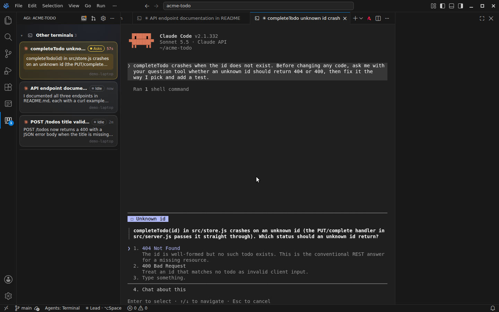
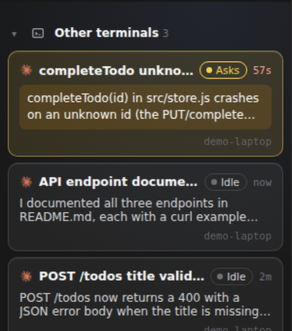

# Agents

Run Claude Code, Codex, Antigravity and other coding agents as editor tabs, and see every
agent at a glance: what it is doing, what it made, and which one is waiting on you.



## What you get

- **Every agent is a tab.** Each agent runs in its own editor tab next to your code, titled
  by what it is working on.
- **One card per agent.** The AGI panel shows each agent's state and its latest words. An
  agent waiting on you turns amber and moves to the top, with its question on the card.
- **Find any session.** Press Cmd+K (Ctrl+K on Linux) in the AGI panel to search every
  session on this machine by title, and open the one you want.



## Get started

1. **Install this extension.** When it asks to install the agents CLI, click **Install**. It
   runs `npm install -g @phnx-labs/agents-cli` in a terminal (Node.js 22.5 or newer).
2. **Set up the CLI and add an agent** in that terminal:
   ```bash
   agents setup              # once; press Ctrl+C at the menu of optional extras
   agents add claude         # or codex, antigravity, cursor, opencode, grok
   ```
   Sign the agent in the way you normally would. For Claude Code, run `claude`, then `/login`.
3. **Register your project** so the AGI panel lists its agents. Run this in the project
   folder:
   ```bash
   agents projects add my-app
   ```
4. **Start an agent:** open the Command Palette and run **Agents: New Claude (Local)**. To
   make **Agents: New Claude** and the new-agent shortcut always start on this machine, set
   `agents.launch.defaultTarget` to `local`.

## What it touches

- **Your editor:** two views in the activity bar (Agents and AGI), a few status bar
  items, and keyboard shortcuts for new agents. It also opens Markdown and HTML files in its
  own reader. Use **Reopen Editor With…** to switch back.
- **Your disk:** the agents CLI keeps its state in `~/.agents`. Each agent keeps its own
  configuration where it always does, such as `~/.claude` or `~/.codex`.
- **Permissions:** from agents-cli 1.23.54, `agents add` asks before installing hooks or
  rules that auto-approve commands. Both start unchecked, and the prompt says what each does.
- **Your code and keys:** agents run on your machine with your own sign-in, and talk to
  their own vendor (Anthropic, OpenAI, Google). This extension sends no telemetry. Its only
  network requests download profile pictures (GitHub, Linear, Gravatar) and pages you pin.
- **Typing into tabs:** the extension types into an agent's tab only when you answer from a
  card or send a reply.

## Requirements

- VS Code or VSCodium 1.85 or newer, on macOS or Linux
- Node.js 22.5 or newer for the agents CLI
- At least one coding agent you can sign in to

## Links

- [Changelog](CHANGELOG.md)
- [Report a problem](https://github.com/phnx-labs/agi-ext/issues)
- [Developing this extension](docs/DEVELOPING.md)
