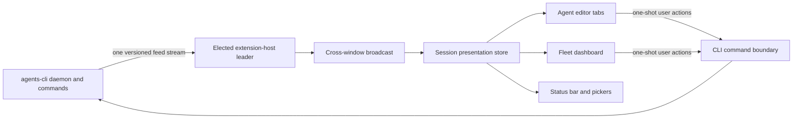
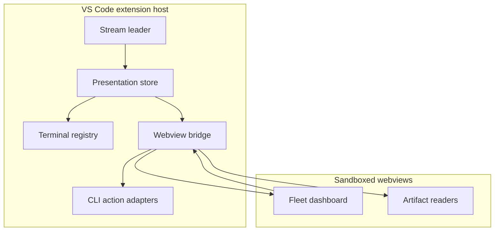

# Architecture

AGI EXT is a presentation and interaction layer over agents-cli. It owns editor tabs,
webviews, local presentation preferences, and the mapping between those surfaces. It does
not own agent execution, session discovery, lifecycle classification, fleet scheduling,
accounts, routines, or watchdog decisions.

## Ownership boundary

The CLI owns facts: sessions, devices, accounts, executions, teams, attention items, and
activity. The extension owns presentation: which tab is visible, local labels, dashboard
layout, and transient UI selection. When the UI needs a missing fact, the fact is added to
the CLI stream rather than reconstructed from transcripts or fetched on a polling loop.

User actions cross the boundary as one-shot CLI verbs. The extension may ask to launch,
resume, stop, fork, dispatch, or merge, but it does not retry those actions on a timer or
create an alternative scheduler.

## Runtime components

The extension host contains the elected stream leader, presentation store, terminal
registry, command adapters, and webview bridge. React webviews render serializable view
models and emit user intent back to the host. The separate agents-dbg Electron app is
another presentation shell over the same concepts; it does not become a state owner.

## Design invariants

- One elected child process receives live CLI state for all windows.
- A reset replaces the scoped presentation model; increments apply monotonically.
- UI code never parses harness transcripts or reads raw agents configuration.
- Acting timers belong to the CLI daemon, not the extension host or webview.
- User actions invoke the CLI noun that owns the concept exactly once.
- Missing CLI capabilities fail as upgrade errors; they do not trigger filesystem
  fallbacks.
- Publisher and URI authority remain `swarmify.swarm-ext` for marketplace continuity.

Implementation debt that violates these boundaries is recorded in `AGENTS.md`. New work
shrinks that debt rather than treating it as precedent.

