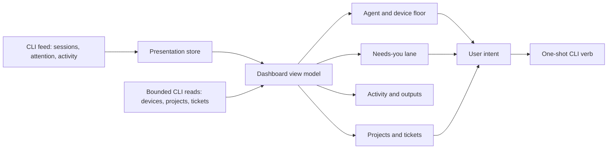
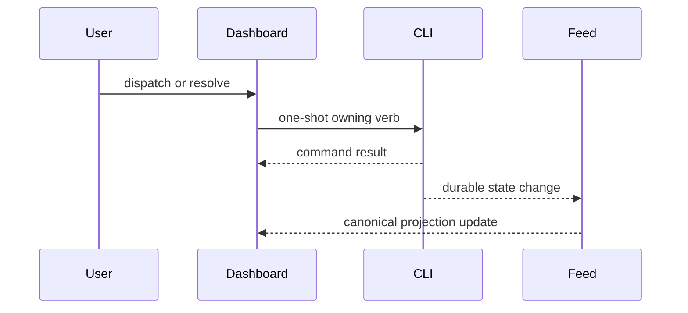

# Fleet dashboard

The Fleet dashboard is a visual projection of CLI-owned sessions, executions, devices,
attention, and activity. It combines those facts for operator comprehension but does not
become their lifecycle owner.

## Composition model

Feed session rows describe interactive conversations and progress. Attention facts
preserve the exact question, choices, and resolution lifecycle. Activity facts provide
chronological evidence such as plans, pull requests, teams, and artifacts. Device,
project, and ticket views currently arrive through separate bounded CLI reads; they do
not live in `SessionPresentationStore`.

The dashboard may group, filter, sort, and decorate those facts. It must not infer a new
canonical session status from transcript text or process scans. Background work can be
hidden by presentation policy without disappearing from the underlying model.

## One preview

The dashboard is a LIST. It does not preview a session: selecting a row posts
`session.select` to the extension host, which points the native `agentsPanel.terminal`
sidebar at that session and reveals it without taking focus. There is no detail rail, no
persisted "detail open" layout pref, and no per-selection `sessions preview` fetch — a
click costs zero subprocesses. The list keeps search, filters, grouping, the row Resume
button, and the expand-in-place card behind its chevron.

That collapses two competing session views into one and removes the whole class of
defect a persisted rail pref produced: a blank third-width column restored on open with
nothing selected.

## Interaction model

Cards and lanes emit intent: focus a tab, resume a session, answer a request, dispatch a
ticket, open an artifact, or invoke another owning CLI action. Optimistic UI is limited
to transient interaction feedback. Durable state changes arrive back through the feed.

## Cross-window behavior

All dashboard windows consume the same broadcast stream and pure presentation store for
feed-backed facts. Opening a second dashboard must not double long-lived CLI watchers,
transcript parsing, or action schedulers. A follower recovers replayable session and
attention state from the elected leader or waits for a reset; activity replay is known
debt. Devices, projects, and tickets remain explicit bounded query paths until the CLI
stream owns those projections too.

The webview bridge serializes a bounded view model and receives typed user messages.
Native VS Code APIs and CLI execution remain in the extension host. This keeps the
webview sandbox presentation-only and makes the same core model reusable by agents-dbg.
