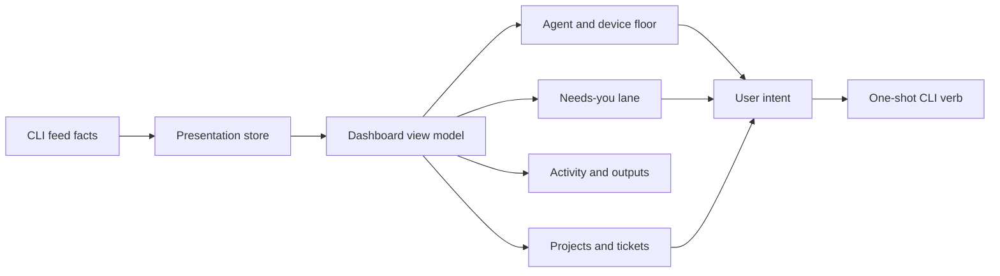
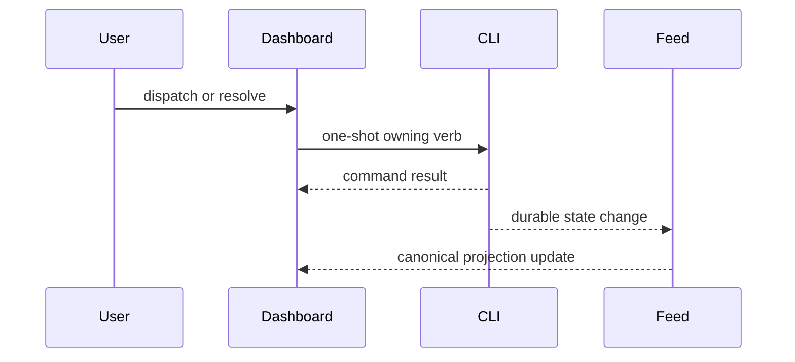

# Fleet dashboard

The Fleet dashboard is a visual projection of CLI-owned sessions, executions, devices,
attention, and activity. It combines those facts for operator comprehension but does not
become their lifecycle owner.

## Composition model

Session rows describe interactive conversations and progress. Execution rows cover work
that may not have a conversation. Device facts provide placement and availability.
Attention facts preserve the exact question, choices, and resolution lifecycle. Activity
facts provide chronological evidence such as plans, pull requests, teams, and artifacts.

The dashboard may group, filter, sort, and decorate those facts. It must not infer a new
canonical session status from transcript text or process scans. Background work can be
hidden by presentation policy without disappearing from the underlying model.

## Interaction model

Cards and lanes emit intent: focus a tab, resume a session, answer a request, dispatch a
ticket, open an artifact, or invoke another owning CLI action. Optimistic UI is limited
to transient interaction feedback. Durable state changes arrive back through the feed.

## Cross-window behavior

All dashboard windows consume the same broadcast stream and pure presentation store.
Opening a second dashboard must not double CLI watchers, transcript parsing, or action
schedulers. A follower that misses history requests replay from the elected leader or
waits for a reset; it does not independently reconstruct fleet state.

The webview bridge serializes a bounded view model and receives typed user messages.
Native VS Code APIs and CLI execution remain in the extension host. This keeps the
webview sandbox presentation-only and makes the same core model reusable by agents-dbg.

