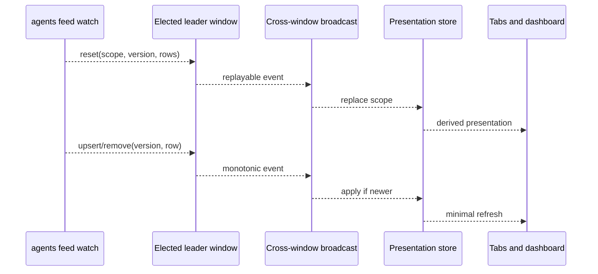
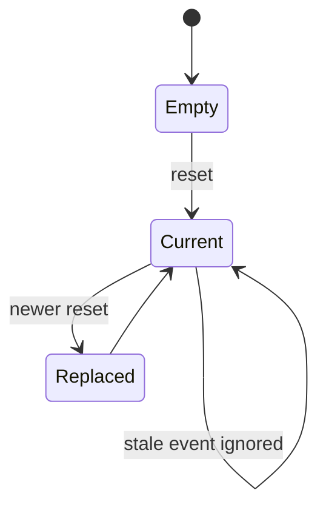

# Session projection

The extension renders CLI-owned session and activity facts through one versioned stream.
It does not discover sessions or decide their lifecycle. This separation keeps multiple
VS Code windows from multiplying process scans, transcript reads, and remote requests.

## Leader and replay

Exactly one elected extension window starts the long-lived CLI feed child, and only
while a window reports demand (a visible dashboard/sidebar, or a tracked agent tab
whose identity the stream has not resolved yet). When no window demands it, the
producer is torn down, so an idle window contributes no watcher at all.

The leader normalizes newline-delimited events and broadcasts them to follower
windows. A child that keeps dying is respawned with exponential backoff up to 30 s
rather than on a fixed short timer, and its process group is torn down before a
restart so an ssh descendant can never outlive it.

If the child exits, the stream owner reports the fault and restarts the read channel.
That restart is not an agent action and does not mutate fleet state. Consumers remain on
their last coherent model until a newer reset arrives.

## Presentation store

The store indexes session rows, activity, attention, and device-scoped facts for UI
consumers. Scope and sequence prevent a delayed event from resurrecting an item removed
by a newer reset. Selectors derive local/remote groupings, visible sessions, counts, and
terminal identity without becoming new sources of truth.

## Session-to-tab correlation

An editor terminal has an extension-local terminal identifier before the harness may
reveal its native session identifier. Launch metadata and CLI stream facts converge on
the terminal registry. Once correlated, the canonical CLI session ID drives status,
labels, resume, fork, stop, and dashboard links.

The extension may retain presentation metadata needed to restore a tab, but it does not
cache a candidate harness session or parse transcript directories to manufacture one.
When identity is absent from the stream, the correct fix is a CLI projection change.

## Needs-you attention

The Fleet "Needs you" section is a pure projection of the CLI attention rows the stream
carries (`RemoteAttention` in `src/core/remoteSessions.ts`, joined onto their session in
`sessionPresentationStore.sessions()`). The extension classifies nothing:

- **Membership** is `attention.state === 'open'`, never a client heuristic. An
  as-yet-unindexed local tab carries no attention and so never enters the section from the
  client side — the moment the stream indexes it, the projected row supplies the real
  attention.
- **Per-row reason and order** come from `attention.kind`. `ATTENTION_KIND_RANK`
  (`floorModel.ts`) is the single ranker: question → permission → plan_review → declared →
  failure → stall → review, most-stuck-first within a kind. An interactive hand-back
  (question / permission / plan_review / declared) renders as a decision card, a failure as
  a failure card, and a stall / review as a plain row.
- **Stall is a CLI signal, not a client guess.** A wedged agent is `attention.kind ===
  'stall'` on the stream. The extension does not run a wall-clock heartbeat threshold to
  invent a "stalled" state, and `FloorPhase` carries no `stalled` member — phase is a
  straight rename of the CLI-reported status (`RemotePhase`; `phaseFromStatus` for an
  unindexed local tab). `PHASE_PROGRESS_RANK` orders that CLI-provided phase on the
  Sessions surface and the feed's idle/running/done lanes; it is not the needs-you ranker.

If a field the section needs is ever absent from the stream, the fix is a CLI projection
change (add it to the attention row), never a client re-derivation.

## Failure semantics

- A missing CLI binary is a visible prerequisite failure.
- A malformed feed event is rejected and reported without corrupting the current scope.
- Loss of the leader triggers election/replay, not one poller per follower.
- Missing facts render as unknown or degraded; zero is reserved for known zero.
  The presentation store records whether it has ever observed a `reset`; a follower
  that has not is rendered as degraded rather than as an authoritative empty state.
- Resolved attention cannot reappear from an older session snapshot.

The concrete stream owner is `src/monitor/sessionCliStream.ts`; the demand gate that
starts and stops it is `MonitorHost` plus `src/monitor/sessionDemand.ts`; the pure
cross-surface model is `src/core/sessionPresentationStore.ts`.

## Row fields the sidebar reads

Beyond the identity/lifecycle fields, the row carries the summarizer's `goal`,
`checkpoints`, `summaryChecklist` and `summaryState`, and the daemon-computed
`request`, `timeline` and `files` (PHNX-3939). `src/core/remoteSessions.ts`
normalizes all three at the boundary — bounded to 2,000 request chars, 8 timeline
steps and 8 file rows — and returns `undefined` for anything the CLI did not send, so
an older CLI degrades to the documented fallbacks (request → `userPromptClean` →
topic, timeline → `checkpoints`, files → nothing) instead of rendering a guess.
