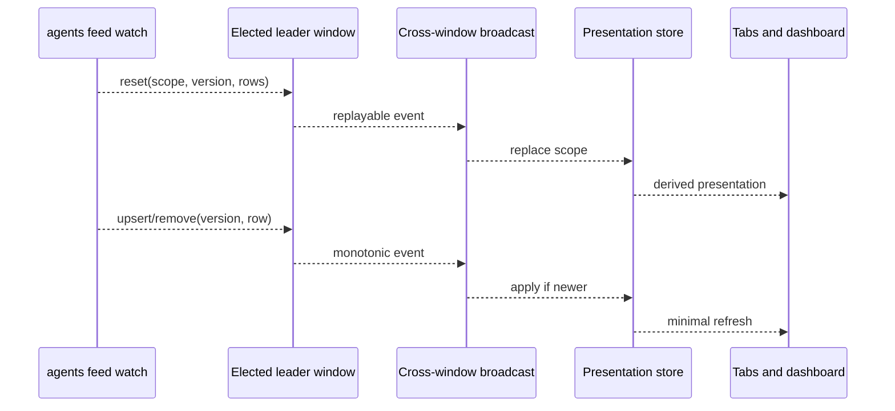
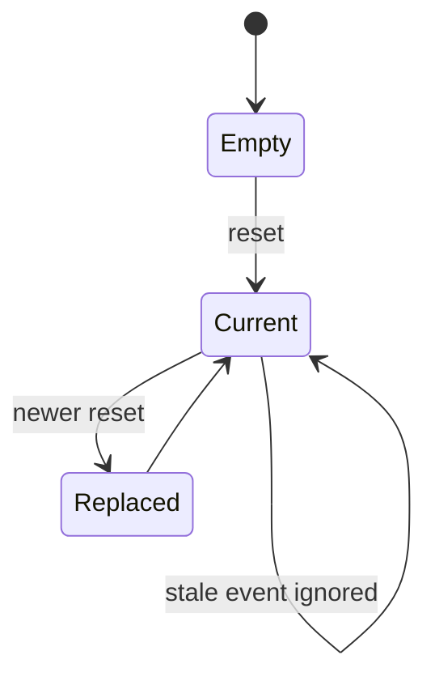

# Session projection

The extension renders CLI-owned session and activity facts through one versioned stream.
It does not discover sessions or decide their lifecycle. This separation keeps multiple
VS Code windows from multiplying process scans, transcript reads, and remote requests.

## Leader and replay

Exactly one elected extension window starts the long-lived CLI feed child. The leader
normalizes newline-delimited events and broadcasts them to follower windows. It retains
the latest session rows, attention rows, and scope status so a newly opened window can
recover those views without starting another CLI process. Activity events are forwarded
live but are not currently included in leader replay; a late follower does not receive a
complete historical activity lane until the CLI/store contract grows that snapshot.

If the child exits, the stream owner reports the fault and restarts the read channel.
That restart is not an agent action and does not mutate fleet state. Consumers remain on
their last coherent model until a newer reset arrives.

## Presentation store

The store indexes session rows, activity, attention, and device-scoped facts for UI
consumers. Scope and sequence prevent a delayed event from resurrecting an item removed
by a newer reset. Selectors derive local/remote groupings, visible sessions, counts, and
terminal identity without becoming new sources of truth.

## Session-to-tab correlation

An editor terminal has an extension-local terminal identifier before the harness may
reveal its native session identifier. Launch metadata and CLI stream facts converge on
the terminal registry. Once correlated, the canonical CLI session ID drives status,
labels, resume, fork, stop, and dashboard links.

The extension may retain presentation metadata needed to restore a tab, but it does not
cache a candidate harness session or parse transcript directories to manufacture one.
When identity is absent from the stream, the correct fix is a CLI projection change.

## Failure semantics

- A missing CLI binary is a visible prerequisite failure.
- A malformed feed event is rejected and reported without corrupting the current scope.
- Loss of the leader triggers election/replay, not one poller per follower.
- Missing facts render as unknown or degraded; zero is reserved for known zero.
- Resolved attention cannot reappear from an older session snapshot.

The concrete stream owner is `src/monitor/sessionCliStream.ts`; the pure cross-surface
model is `src/core/sessionPresentationStore.ts`.
