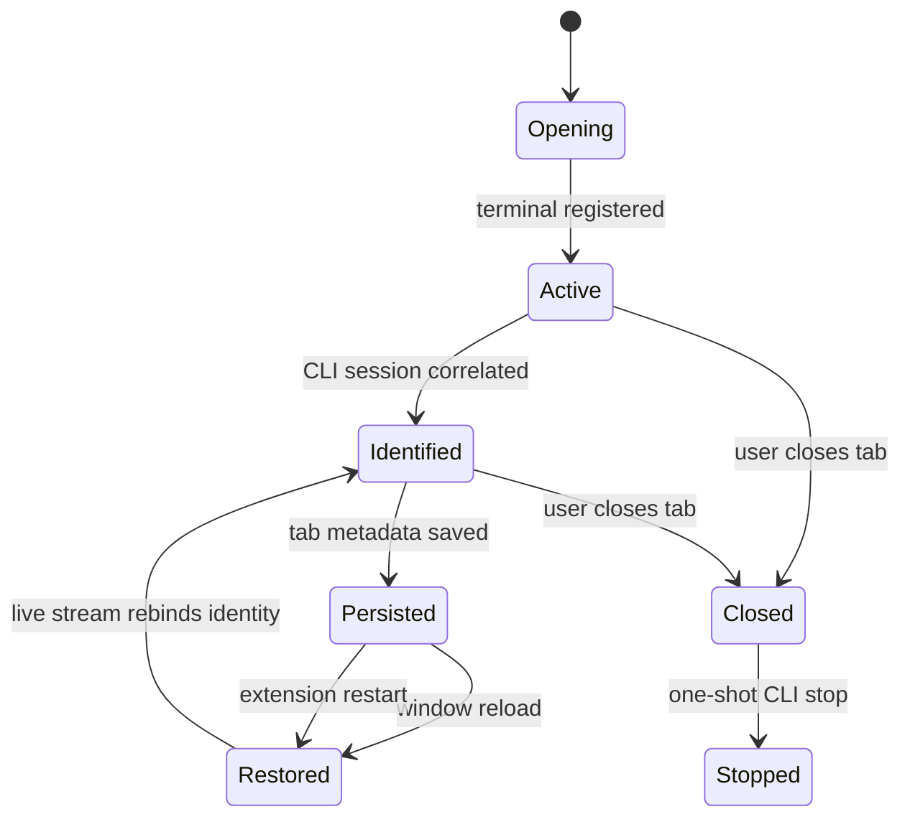
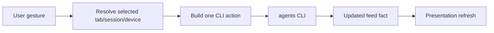

# Terminal lifecycle

Agent terminals are VS Code editor tabs backed by ordinary terminal processes. The
extension owns tab presentation and restoration metadata; agents-cli owns the launched
agent and its durable conversation.

## Registration and identity

The terminal registry associates a VS Code terminal object with extension-local identity,
harness, target device, version/account presentation, and the canonical session ID once
known. The stream is authoritative for session identity and status. Local launch facts
bridge only the interval before that identity is available.

Labels have two classes: a canonical session-derived title and an explicit user label.
The user label wins because it is presentation intent; neither label changes the
underlying conversation identity.

## Persistence and restoration

Restoration metadata records enough presentation context to reopen an agent tab after a
window reload. Reopening routes through the CLI's resume semantics and then rebinds the
tab from the live stream. Persisted metadata is not proof that a process is still alive,
nor is it a transcript cache.

Reload and user close are distinct events. Reload preserves the session. A genuine user
close issues one explicit stop request for the correlated session. Treating all terminal
disposal as user intent would kill agents during ordinary editor lifecycle events.

## User actions

Launch, resume, fork, stop, relabel, and host/harness rotation originate from explicit
commands or gestures. The extension resolves UI selection, then calls the owning CLI
command. It does not reproduce resume compatibility, account selection, placement, or
fork identity rules.

The terminal registry and persistence seam live in `src/vscode/terminals.vscode.ts` and
`src/core/sessions.persist.ts`. CLI location and invocation are centralized in
`src/core/agentsBin.ts` so individual features cannot invent divergent binary lookup.

